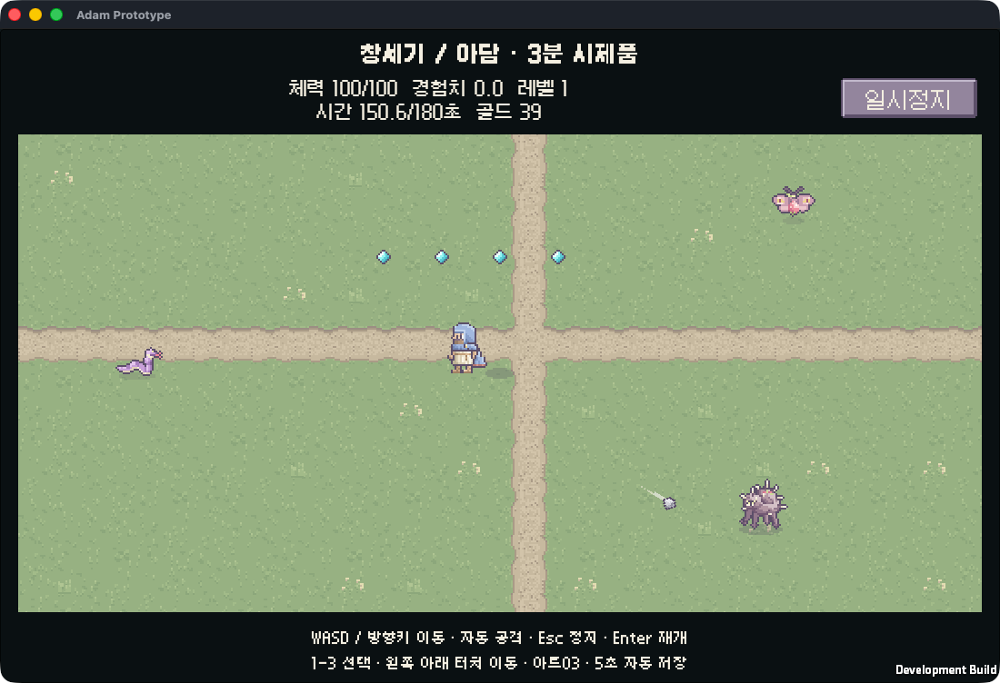

# Bible Survivor

성경의 인물·사건·상징을 소재로 한 Unity 기반 탑다운 2D 픽셀 서바이벌 게임 프로젝트입니다. 플레이어는 자신의 캐릭터를 만들고 성경 이야기에서 착안한 적과 싸우며 무기와 영구 스킬을 성장시킵니다.

## 현재 상태

아담 R01과 가인 R02의 Unity 독립 C# 코어·연속 진행·자동 검증을 개발하고 있습니다. R02 완료 후 R03 보스 라운드는 진입 대기로 보존합니다. 이 코어 검증은 Unity 화면·입력·기기 플레이 검증과 별개입니다. 문서의 전투 수치와 경제 수치는 초기 설계이며 플레이 검증 결과가 아닙니다. 전체 스킬 420종은 목표 규모이며, 무기 전용 300종의 효과 개요를 작성했습니다.

[R01 구현·검증 상태](docs/progress/R01.md) · [R02 구현·검증 상태](docs/progress/R02.md) · [개발 계획](docs/genesis-development-plan.md) · [모바일 고려 사항](docs/mobile-platform-plan.md)

`UnityGame/`은 Unity 6000.6.9f1용 아담 시제품입니다. 프로젝트에서 `Assets/Scenes/Adam.unity`를 열어 실행합니다. 검수된 픽셀 아트03·6레이어 캐릭터·적3종·세 무기 표현·외곽선 한국어 폰트를 연결했습니다. [아트 연결·실제 시험·한계](docs/progress/unity-art.md)와 [기반 시제품 기록](docs/progress/unity-adam.md)을 구분합니다. 현재 외형 편집·후속 보스·모바일 실기기·성능은 미완료입니다. Core를 변경하면 `python3 tools/unity_sync_core.py`로 동기화한 뒤 Unity 컴파일과 관련 시험을 다시 실행해야 합니다.

iOS Simulator의 지정 휴대폰 profile에서 IL2CPP 빌드·터치·세로/가로 UI·중단/재실행 저장 복구를 검증했고 독립 코드/UI 리뷰를 통과했습니다. [iOS 검증 범위와 남은 게이트](docs/progress/mobile-ios.md)를 확인하세요. Android·다른 화면 크기·실물 기기·성능은 별도 검증 대상입니다.



macOS 개발 빌드의 시각 검토용 배치입니다. 적·경험치 위치를 연출했으며 자연 전투 밀도나 밸런스 검증 화면은 아닙니다.

## 코어 검사 실행

.NET SDK 10.0.404와 Python 3를 준비한 환경에서:

```sh
python3 tools/check_all.py
python3 tools/check_mutations.py
bash tools/dotnet.sh run --project tools/BibleSurvivor.Sim -- bible
bash tools/dotnet.sh run --project tools/BibleSurvivor.Sim -- --combat sling 7
bash tools/dotnet.sh run --project tools/BibleSurvivor.Sim -- --series sling
bash tools/dotnet.sh run --project tools/BibleSurvivor.Sim -- --series-combat sling 7
```

기본 명령은 처치를 주입해 규칙을 확인합니다. `--combat`은 60Hz 좌표 전투에서 적 추적·자동 공격·명중·처치·거리 회수와 중간 저장/복원을 실행합니다. 무기는 `bible`, `jawbone`, `sling`이며 마지막 숫자는 시드입니다. 이 CLI는 Unity 화면·입력·기기 성능을 검증하지 않습니다. 실제 Unity 시험은 별도 진행 문서에 기록합니다. [코어 하네스 안내](docs/harness/standalone-core.md)

`--series`는 R01→R02 예산/성장을 처치 주입으로 확인하고, `--series-combat`은 같은 진행을 실제 좌표 전투로 실행합니다. 라운드별 중간 저장·완료 저장·R02 진입 저장을 복원합니다. 정상 라운드는 시간 종료로도 완료되므로 출력의 실제 처치 수를 함께 확인합니다. 해금된 `wilderness_voice`·`lightning`은 아직 장착/공격을 구현하지 않았습니다.

## 기획 문서

- [전체 게임 기획](docs/game-design.md)
- [창세기 라운드·전투 설계](docs/genesis-balance.md)
- [무기·보조 아이템·진화](docs/item-recommendations.md)
- [영구 스킬트리](docs/skill-tree.md)
- [무기별 스킬 300종](docs/weapon-skill-trees.md)
- [골드·구매·환불](docs/gold-shop.md)

## 개발 순서

첫 목표는 아담 라운드의 3분 전투입니다. 회전 성경·삼손의 턱뼈·다윗의 물맷돌을 시작으로 1~3라운드와 노아 보스를 구현하고, 검증 후 창세기 9라운드 및 후속 책으로 확장합니다.

기획·아트·개발·QA·독립 리뷰를 연결하는 로컬 전용 하네스를 사용합니다. 이 저장소에는 실행 가능한 코어 검사·콘텐츠 검사·회귀 변이 검사와 CI 정의를 포함합니다. Unity 검증은 설치 후 별도로 연결합니다.

게임의 적·보스·무기 효과에는 창작이 포함됩니다. 성경 본문의 내용과 게임적 각색은 기획 문서에서 구분합니다. 그래픽과 UI는 이 프로젝트의 독자적인 에셋으로 제작합니다.
