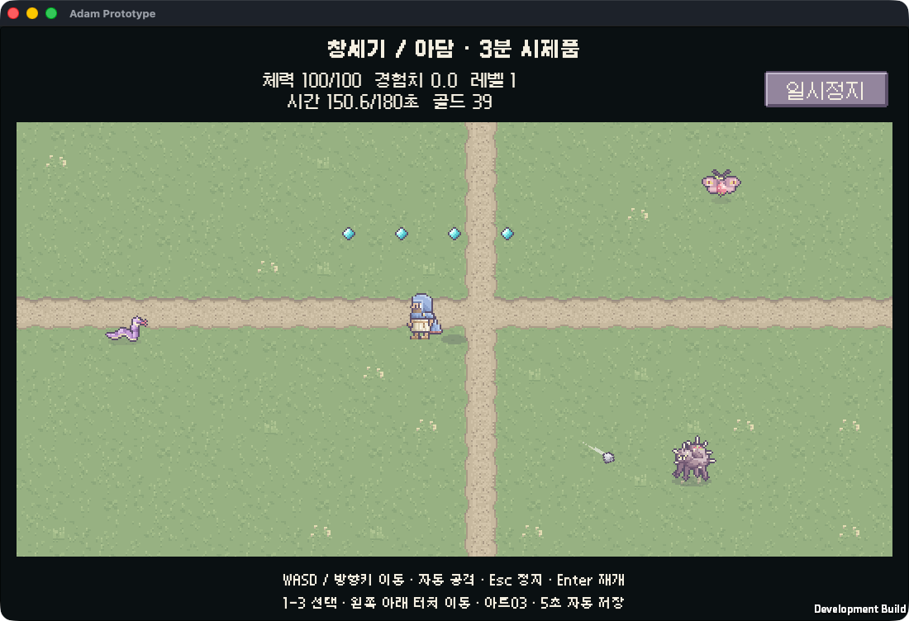

# Bible Survivor

성경의 인물·사건·상징을 소재로 한 Unity 기반 탑다운 2D 픽셀 서바이벌 게임 프로젝트입니다. 플레이어는 자신의 캐릭터를 만들고 성경 이야기에서 착안한 적과 싸우며 무기와 영구 스킬을 성장시킵니다.

## 현재 상태

창세기 R01~R09와 출애굽기 첫 라운드 R10을 C# 코어와 Unity PC 시제품에 연결했습니다. 유다 R09 완료 뒤 장비·성장·세 보상 기록을 보존하고 명시적으로 출애굽기를 시작하며, R10 완료는 R11 대기로 저장합니다. 새 도전은 별도 선택일 때만 시작합니다. 기술 검증과 자연 플레이 밸런스 검증은 별개이며, 문서의 전투·경제 수치는 초기 설계입니다. 전체 스킬 420종은 목표 규모이며, 무기 전용 300종의 효과 개요를 작성했습니다.

[R10 출애굽기 진입과 PC 검증](docs/progress/R10-unity.md)에 저장 성공 후 진입·실패 재시도·첫 라운드 적3종·완료 정산과 기술 fixture의 한계를 기록했습니다. 관련 Edit47/Play22 및 최종 PC 앱을 확인했으며, 출애굽기 전체 R10~R15 구현은 계속 진행합니다. 최신 챕터의 자연 밸런스·native·모바일·성능은 미검증입니다.

[R01 구현·검증 상태](docs/progress/R01.md) · [R02 구현·검증 상태](docs/progress/R02.md) · [개발 계획](docs/genesis-development-plan.md) · [모바일 고려 사항](docs/mobile-platform-plan.md)

`UnityGame/`은 Unity 6000.6.9f1용 아담 시제품입니다. 프로젝트에서 `Assets/Scenes/Adam.unity`를 열어 실행합니다. 검수된 픽셀 아트03·6레이어 캐릭터·적3종·세 무기 표현·외곽선 한국어 폰트를 연결했습니다. [아트 연결·실제 시험·한계](docs/progress/unity-art.md)와 [기반 시제품 기록](docs/progress/unity-adam.md)을 구분합니다. 현재 외형 편집·후속 보스·모바일 실기기·성능은 미완료입니다. Core를 변경하면 `python3 tools/unity_sync_core.py`로 동기화한 뒤 Unity 컴파일과 관련 시험을 다시 실행해야 합니다.

[가인 R02 기술 연결](docs/progress/unity-r02.md)과 [R02 실제 적 시트 연결](docs/progress/unity-r02-art.md)에 연속 성장·세 적의 애니메이션·깊이 정렬·피격 실루엣·발 pivot 정정을 기록했습니다. [R03 PC 통합](docs/progress/R03-unity.md)은 보스전·보상/진화·남은 성장·정산·저장 재개를 연결했으며 컴파일·Edit97/Play31·macOS 빌드와 대표 기술 전투를 확인했습니다. [성경 가독성 개선](docs/progress/bible-readability-unity.md)은 기존 아트 원본을 보존하면서 책 디테일과 후광을 개선했습니다. native 연속 조작·자연 밸런스·최신 R03 모바일/IL2CPP·실물/성능은 미검증입니다.

[schema2 저장 준비](docs/progress/r03-schema.md)는 기존 R01/R02 저장의 무쓰기 읽기·최초 갱신 전 원문 보존·미래 저장/전투 버전의 덮어쓰기 방지를 지원합니다. 순수 Core와 macOS Player 검증 범위를 분리하며 새 저장 코드의 IL2CPP/모바일 검증은 아직 하지 않았습니다.

[R04 PC 통합](docs/progress/R04-unity.md)은 아브라함 라운드의 새 적 3종·예고 돌진·넉백과 동기화되는 저효과 경고선·중간 저장 재개·완료 정산을 연결했습니다. 컴파일·Edit102/Play31·단일 macOS 빌드를 확인했고, 대표 화면과 기술 fixture의 검증 범위를 진행 문서에 구분했습니다. 최신 R04의 자연 밸런스·native 조작·모바일/IL2CPP·실물/성능은 미검증입니다.

[R05 PC 통합](docs/progress/R05-unity.md)은 롯 라운드의 추적형 적 3종·중간 저장 재개·성장 후80골드/해금/회복·R06 대기를 연결했습니다. Edit106/Play31·단일 macOS 빌드와 기술 fixture를 확인했습니다. 빠른 E3의 플레이어 겹침으로 대표 정지 화면의 가독성 판정에는 한계가 있으며 자연 밸런스·native 조작·모바일/성능은 미검증입니다.

[R06 PC 통합](docs/progress/R06-unity.md)은 싯나의 우물지기·두 번의 지원군 소환·고정 지점 예고 공격·보상/진화·과거 보상 기록 보존·완료/저장 재개를 연결했습니다. 관련26·Edit111/Play31과 실제 좌표 보스전을 확인했고, 이후 보상명 두 표현을 수정한 최종 앱은 정상 빌드·보상 화면으로 확인했습니다. 기술 준비·실패와 추가 빌드·기존 화면 재사용 범위는 진행 문서에 구분했습니다. 자연 밸런스·native 조작·최신 모바일/성능은 미검증입니다.

[R07 PC 통합](docs/progress/R07-unity.md)은 야곱 라운드의 적 3종·G3 실제 좌우 생성/독립HP·두 보스 보상 기록 보존·성장 후120골드/해금/회복·저장 재개를 연결했습니다. 관련22·Edit116/Play31·최종 PC 앱과 대표 초기 좌우 화면을 확인했습니다. Core의899킬 timeout과 앱의 기술 처치/성장 fixture는 구분하며 자연밸런스·native 조작·모바일/성능은 미검증입니다.

[R08 PC 통합](docs/progress/R08-unity.md)은 요셉 라운드의 적 3종·해금 없는140골드/회복·저장 재개와 일반 성장 고갈 시 골드25 선택을 연결했습니다. 관련25·Edit121/Play31·단일 PC 앱에서 후보Load무지급/선택once·실제 정산pending2/선택2의50골드와 완료140을 구분해 확인했습니다. 이전 R07의 후보3개를 성장3회로 쓴 보고는 실제 선택1회로 정정했습니다. 당시 R08 종료 뒤 사용자 요청으로 R09를 재개했으며 추가 무기/모바일/최적화는 범위 밖입니다.

[R09 PC 통합](docs/progress/R09-unity.md)은 은잔의 참소자·세 방향 사슬 투사체/저효과 예고·지원군·보상 진화·창세기 완료 저장을 연결했습니다. Core의 R01~R09 실제 좌표 연속 CLI 한 번이 통과했으며 초기 장비8/보조1·HP10000의 기술 준비와 자연 난이도 검증을 구분했습니다. Unity Edit136개는 최초135개와 importer 교정 후1개의 합이며 Play31·최종 PC 앱에서 R09 표현/저장/완료를 확인했습니다. 앱의 직접 피해·처치/timeout fixture를 9라운드 자연 완주로 세지 않습니다. Claude를 제외한 Codex 제작 아트·UI/월드/Host 병행과 단독 Editor 통합을 사용했습니다. 다음 책·나머지 무기/스킬·모바일/성능은 후속 범위입니다.

iOS Simulator의 지정 휴대폰 profile에서 IL2CPP 빌드·터치·세로/가로 UI·중단/재실행 저장 복구를 검증했고 독립 코드/UI 리뷰를 통과했습니다. [iOS 검증 범위와 남은 게이트](docs/progress/mobile-ios.md)를 확인하세요. Android·다른 화면 크기·실물 기기·성능은 별도 검증 대상입니다.

PC 타격감 P0에 정확한 명중 사건·적 피격 반응·세 무기 효과음과 저효과/음량 설정을 추가했습니다. [P0 검증 범위](docs/progress/combat-feedback.md)의 독립 코드·PC 화면/조작 리뷰와 청감 미검증을 구분합니다. Unity 기본 파티클도 실제 게임 화면에 연결했고 [파티클 구현·회귀·한정 성능 측정](docs/progress/combat-particles.md)을 기록했습니다. 최신 앱의 native 연속 전투 조작·GPU/모바일 실물 성능은 미검증입니다. Android 최소 빌드·저장 복구 근거는 [Android 진행 문서](docs/progress/mobile-android.md)에 있습니다.



macOS 개발 빌드의 시각 검토용 배치입니다. 적·경험치 위치를 연출했으며 자연 전투 밀도나 밸런스 검증 화면은 아닙니다.

## 코어 검사 실행

.NET SDK 10.0.404와 Python 3를 준비한 환경에서:

```sh
python3 tools/check_all.py
python3 tools/check_mutations.py
python3 tools/check_schema_compat.py
python3 tools/check_schema_mutations.py
python3 -I -S -B tools/unity_prepare_r02_art.py
bash tools/dotnet.sh run --project tools/BibleSurvivor.Sim -- bible
bash tools/dotnet.sh run --project tools/BibleSurvivor.Sim -- --combat sling 7
bash tools/dotnet.sh run --project tools/BibleSurvivor.Sim -- --series sling
bash tools/dotnet.sh run --project tools/BibleSurvivor.Sim -- --series-combat sling 7
```

기본 명령은 처치를 주입해 규칙을 확인합니다. `--combat`은 60Hz 좌표 전투에서 적 추적·자동 공격·명중·처치·거리 회수와 중간 저장/복원을 실행합니다. 무기는 `bible`, `jawbone`, `sling`이며 마지막 숫자는 시드입니다. 이 CLI는 Unity 화면·입력·기기 성능을 검증하지 않습니다. 실제 Unity 시험은 별도 진행 문서에 기록합니다. [코어 하네스 안내](docs/harness/standalone-core.md)

`--series`는 R01→R02 예산/성장을 처치 주입으로 확인하고, `--series-combat`은 같은 진행을 실제 좌표 전투로 실행합니다. 라운드별 중간 저장·완료 저장·R02 진입 저장을 복원합니다. 정상 라운드는 시간 종료로도 완료되므로 출력의 실제 처치 수를 함께 확인합니다. 해금된 `wilderness_voice`·`lightning`은 아직 장착/공격을 구현하지 않았습니다.

## 기획 문서

- [전체 게임 기획](docs/game-design.md)
- [창세기 라운드·전투 설계](docs/genesis-balance.md)
- [출애굽기 라운드 기획](docs/exodus-balance.md) · [제작 계획](docs/harness/exodus-development-plan.md)
- [무기·보조 아이템·진화](docs/item-recommendations.md)
- [영구 스킬트리](docs/skill-tree.md)
- [무기별 스킬 300종](docs/weapon-skill-trees.md)
- [골드·구매·환불](docs/gold-shop.md)

## 개발 순서

첫 목표는 아담 라운드의 3분 전투입니다. 회전 성경·삼손의 턱뼈·다윗의 물맷돌을 시작으로 1~3라운드와 노아 보스를 구현하고, 검증 후 창세기 9라운드 및 후속 책으로 확장합니다.

기획·아트·개발·QA·독립 리뷰를 연결하는 로컬 전용 하네스를 사용합니다. 이 저장소에는 실행 가능한 코어 검사·콘텐츠 검사·회귀 변이 검사와 CI 정의를 포함합니다. Unity 검증은 설치 후 별도로 연결합니다.

게임의 적·보스·무기 효과에는 창작이 포함됩니다. 성경 본문의 내용과 게임적 각색은 기획 문서에서 구분합니다. 그래픽과 UI는 이 프로젝트의 독자적인 에셋으로 제작합니다.
