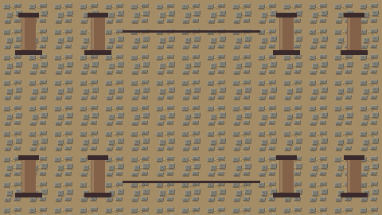

# 창조 이야기와 R09–R10 연결 시제품

첫 R01 저장 뒤 20초 동안 타이머를 0에 둔다. 창조 이야기의 여섯 컷은 첫 빛, 하늘과 물, 물길과 식물, 해·달·별, 물고기와 새, 육지 동물을 순서대로 보여 준다. 여섯째 날의 육지 동물에서 끝나며 다음 화면은 에덴 조작이다. 첫 컷과 시작 화면에는 작은 에덴 나무 봉인을 가장자리에 둔다. 창세기 출전 표시는 화면 가장자리의 작은 라운드명만 보여 준다. [이슈 #56](https://github.com/petercorders/Bible-Survivor/issues/56) 새 저장에서 시작할 때만 자동으로 연다. 이어 하기는 저장된 화면을 복원하며, PC 시작·일시정지·권 완료 화면의 F5 또는 다시 보기 버튼에서 열 수 있다.

R09는 유다와 요셉 이야기의 마지막 두 컷을 13초로 시험한다. 첫 컷은 시간이 지난 뒤 가족을 안심시키는 요셉을, 둘째 컷은 후손을 향한 약속과 회랑 오른쪽 작은 두루마리를 보여 준다. 정산 작업 ID와 리비전, RunId, R09 완료 영수증을 디스크에서 확인한 뒤 재생한다. 중단하거나 리소스가 없어도 이미 저장된 완료 화면에서 출애굽기를 선택한다. 실패 때는 기존 저장 재시도와 다시 불러오기를 사용한다. 성공을 확인한 재시도는 한 번만 영상을 열고 이미 완료된 저장을 불러오면 화면만 복구한다. PC에서는 F10 또는 완료 화면의 다시 보기 버튼으로 영상을 다시 볼 수 있다.

### R09 엔딩에서 R10으로

완료 화면에서 출애굽기 이어 가기를 선택하면 동일 RunId, 정산 영수증과 함께 R10 진입을 저장하고 디스크의 작업 ID·리비전·라운드를 확인한다. 확인 전에는 R09 완료 상태를 유지한다. 재시도는 같은 저장 작업을 확인한 뒤 처음 한 번만 오프닝을 연다. 이미 저장된 R10을 다시 열면 기존 이어 하기 화면으로 복귀한다. 영상 누락이나 스킵은 확정된 R10으로 연결되며, 눌린 확인 입력과 이동 입력은 전장으로 넘기지 않는다.

| 컷 | 장절 | 화면 |
|---|---|---|
| 0–4초 | 출 1:6–7 | 요셉의 약속을 담은 R09 마지막 컷과 같은 구도·조명, 회랑 가장자리 두루마리. 첫 자막에서 여러 세대가 지났음을 밝히고 회랑이 서서히 어두워진다 |
| 4–10초 | 출 1:8–14 | 요셉을 알지 못하는 새 왕, 벽돌을 나르는 사람들의 실루엣과 가마·벽돌 더미 |
| 10–14초 | 출 1:13–14 | R10 전장과 같은 지형 렌더러 및 타일을 사용한 작업장 바닥에서 조작으로 전환 |

R09의 창 50:24–26 컷과 R10의 출 1:6–7 컷은 같은 모티프 ID `egypt-scroll-promise`를 기록한다. 모티프 연결은 데이터로 확인했다. 음원 제작·재생은 보류했다.

480×270 레이어를 중앙에서 정수 배율로 표시하고 장절과 자체 한국어 요약을 화면 UI로 표시한다. Enter·Esc·패드 B/동쪽 버튼 또는 마우스로 건너뛰고, Space·패드 Start 또는 마우스로 일시정지한다. 기존 F6 저감 설정은 컷 안의 움직임을 멈추고 장면 순서·내용·시간을 유지한다.

## 아트 인계

초기 Codex 세션에서 Design 연결을 확보하지 못해 기존 창세기 머릿장, 문장, 캐릭터와 팔레트로 기술 시제품을 구성했다. 이후 담당자가 실제 Claude Design에서 만든 v19 보드와 편집 가능한 장면 소스를 비공개 로컬 인계했다. 작업 결과서에는 Claude Opus 5.5가 기록돼 있다. Codex는 제품의 모델 선택 화면을 직접 확인하지 않았다. Unity용 원본 변환이 필요할 때는 지정된 Claude Code Sonnet 5.5를 사용한다.

| ID | 요청 범위 | 승인 조건 |
|---|---|---|
| `genesis-intro` | 480×270 여섯 컷, 여섯째 날은 육지 동물까지만 표현. 원점은 좌상단이며 하늘·물·땅·생물·빛을 독립 레이어로 분리 | 1920×1080 4배, 660×440 1배. 창세기 팔레트, 첫 프레임 움직임, 정적인 저감 버전, 자막 UI 밑 여백 |
| `genesis-ending` | 480×270의 11–17초, 17–24초 원안에 해당하는 두 장면. 인물 컷 발 기준과 두루마리의 하단 피벗 명시 | 야곱 장례 이후의 안심과 요셉의 약속을 분명히 구분. 마지막은 회랑 가장자리의 작은 두루마리 |
| `genesis-env-eden` · `genesis-env-ark` · `genesis-env-hall` | 물길과 수관, 방주 골조와 판재, 회랑 기둥. 32×32 타일과 검토용 480×270 합성 | 기존 적 공격 경고의 붉은 주황이나 예고 형태와 구분. 전투의 중앙 시야·충돌·피해에 영향 없음 |

### Claude Design v19 독립 검토

보관된 시안에서 3일차 1.45–2.8초의 전후 프레임 다섯 쌍을 비교했다. 화면 안쪽의 뿌리, 줄기와 가지에 붙은 수관, 마지막 열매가 이어져 보인다. 이 배치는 Unity용 레이어 제작으로 넘겼다. 기존 나무 접점은 원본 `y=252`다. 현재 자막판은 1920×1080에서 `y=245`, 660×440에서 `y=255`부터 가린다. 두 크기에서 뿌리와 그림자까지 보이도록 전체 전경 레이어를 `y≤244` 안으로 배치해 달라고 요청했다.

| 구간 | v19에서 확인한 범위 | Unity 실행용 인계 요청 |
|---|---|---|
| 1–2일 | 첫 빛과 하늘·물의 구도 | 빛, 하늘과 수면, 궁창과 위·아래 물 분리 |
| 3일 | 물길과 식물, 전경 나무 성장 | 땅과 물, 뒤쪽 식생, 에덴 봉인, 뿌리·줄기·가지·수관·열매·그림자 및 접점 |
| 4–6일 | 해·달·별, 물고기와 새, 육지 동물까지 | 천체·수면 반사, 물고기·새·육지 동물과 그림자, 땅과 숲 분리. 창 1:25 범위 유지 |
| R09 | 마지막 7초의 회랑과 작은 두루마리 | 앞 6초의 유다와 요셉 장면 및 인물 레이어, 약속 컷의 공통 회랑·조명·두루마리 |
| R10 | 첫 4초 회랑과 마지막 4초 작업장 보드 | 세대가 지난 표식, 중간 6초의 새 왕과 벽돌 노동, 일꾼·가마·연기 및 실제 R10 지형으로 넘기는 배치 |

v19의 미리보기 PNG 19장은 RGB 합성 이미지다. 480×270 편집 장면 코드와 별도로, 각 컷에 팔레트 인덱스, 투명 레이어, 시간·좌표·피벗, 저감 정지 프레임과 해시가 있는 §6.4 인계본을 요청했다. 담당자는 3일차 전경 나무부터 준비한다고 회신했다. 별도 #62의 소품 3종과 그림자 마스크 3종은 크기·알파·해시를 확인했다. 실제 공격 경고 가독성은 해당 전장 자산 검수에 남아 있다.

### v20 3일차 비공개 구현 시험

담당자가 3일차의 12개 배경과 6개 나무 레이어, 12fps 프레임 34장과 저감 정지 프레임을 제작 초안으로 인계했다. 독립 검사에서 파일 해시 40개, 프레임 해시 35개와 레이어 재합성 픽셀이 모두 일치했다. 원본 격자와 PNG의 불일치와 비이진 알파는 0건이었다. 독립 아트 검토에서 성장 중 가지·수관의 연결과 뿌리·그림자를 확인했다. 발아 시 첫 나무 프레임이 크게 등장하며 마지막 두 프레임에는 작은 잎 픽셀이 떨어져 보인다.

3일차는 기존 5.4–8.2초에 맞는다. 비공개 격리 소스에서 원본의 합성 스트립과 저감 정지 이미지를 기존 3일차 그리기 경로에 연결했다. 재생 목적으로 Unity를 열지 않고 macOS·Windows 조건의 Roslyn 명령행 컴파일을 확인했다. 초안 파일과 시험 코드는 로컬에 보관한다. 레이어는 화면에 드러난 픽셀 기준으로 나뉘어 개별 이동 시 뒤의 색을 별도로 채워야 한다. 스트립 폭 16,320px는 플랫폼에 따라 재배치가 필요하다.

나무 접점은 y=240, 그림자 최하단은 y=244다. 현 자막 좌표로 계산했을 때 1920×1080과 660×440에서는 나무가 가려지지 않는다. 고정 100px 자막판은 960×540에서 원본 y=220, 1440×810에서 약 y=237부터 가려 뿌리와 그림자에 겹친다. 실제 Player 화면과 최종 아트 임포트 승인은 보류 상태다. 제품 경로의 기술 시제품은 창 1:25와 R09 정산·이어 가기·R10 오프닝을 유지한다.

### v21 3일차 교체본

v20과 v21을 대조했다. 처음 나무가 나타나는 17번째 프레임은 41px에서 5px로 줄었으며, 동작 합성이 바뀐 프레임은 17–19와 23–26이다. 같은 색을 다시 칠한 픽셀도 마지막에 칠한 레이어에 배정해, v20의 32·33 프레임 및 저감 정지본에서 분리된 조각이 v21에서 사라졌다. 파일 해시 40개와 동작·저감 35프레임의 재합성은 모두 일치한다. 나무와 그림자 최하단은 원본 y=244 이내다.

3일차 격리 시험에서 자막판 높이를 원본 25행의 확대 높이와 하단 여백을 더한 값으로 제한했다. 최대 100px를 유지한다. 계산 결과 1920×1080과 660×440은 100px, 960×540은 50px, 1440×810은 75px다. 네 크기 모두 정수 배율과 뿌리·그림자 노출을 유지한다. macOS·Windows 조건에서 시험 소스의 Roslyn 컴파일을 확인했다. 줄어든 자막과 버튼의 가독성은 실제 Player에서 확인할 항목이다. 제품 브랜치는 고정 자막판과 기술 시제품을 사용한다.

### v22 기존 장면 8개 검증

1·2·4·5·6일차, R09 마지막 회랑, R10 첫 회랑과 벽돌 작업장 제작 초안을 받았다. 동작 389장과 저감 정지 8장의 해시 및 여덟 장면의 동작 레이어 재합성이 일치했다. 동작 R09 마지막과 R10 첫 프레임은 전체 129,600픽셀, 11개 레이어, 3개 마스크가 모두 일치한다. 저감 정지본끼리는 43,161픽셀이 다르다. 양쪽 회랑의 모티프 ID는 일치하며 오디오 파일은 없다.

비공개 구현 시험은 기존 1–5일차 타임라인에 이들 원본과 v21 3일차를 연결했다. macOS·Windows 조건의 Roslyn 명령행 컴파일이 통과했다. 6일차와 R09 회랑, R10 회랑·벽돌 작업장의 합성 스트립 폭은 23,040–40,320px라 16,384px에서도 한 텍스처에 들어가지 않는다. 담당자에게 프레임 순서와 원점을 보존하는 분할 인계 규격을 요청했다. R09 앞 6초, R10 벽돌 컷의 2초 및 실제 전장으로 넘기는 마지막 4초도 남아 있다. 제품은 기존 기술 시제품을 사용한다.

### v23 전체 컷 비공개 연결

R09 간청·안심 6초, R10의 새 왕과 벽돌 노역 6초, 작업장→전장 4초를 받았다. 완성된 초안은 11컷이다. 독립 검사에서 동작 567장과 저감 11장의 해시, 아틀라스 159페이지의 8,131개 프레임 좌표와 원본 스트립 픽셀이 일치했다. 가장 긴 페이지 변은 4,095px다. R09 앞·뒤 컷의 12fps 이음매는 4픽셀, R09 마지막과 R10 첫 화면은 0픽셀 차이다.

비공개 시험 소스에서 11컷을 기존 타임라인에 연결했다. R10 마지막 컷은 3.25초부터 작업장 레이어의 투명 부분 뒤로 실제 R10 지형을 그린다. 기존 전장 영역, 스폰 원점, 정수 배율과 지형 렌더러를 공유한다. 원본의 작업장 알파와 참조 전장 영역이 매 프레임 정확히 맞고, 끝에서 원본 129,600픽셀 전체가 열린다. 저감 모드는 작업장 정지본을 보여 주고 전환 디더를 생략한다. macOS·Windows 조건에서 Roslyn 명령행 컴파일이 통과했다. 실제 창의 이음매와 메모리는 아직 측정하지 않았다. 시험의 야드 7페이지는 RGBA32로 약 94MiB이며 제품 적용 전 텍스처 비용을 확인해야 한다.

오프라인 독립 아트 검토에서는 작은 창에서 유다의 간청과 세월 경과, 새 왕과 감독관의 구분을 자막에 의존하는 것으로 봤다. 1080p 자막판은 작업장 하단의 벽돌·진흙·도구 일부를 가린다. 660×440에서는 하단 벽돌 일부가 가려진다. 이번 초안은 비공개 시험 범위다. 제품은 기존 기술 시제품을 사용하며, Unity 실행·캡처·오디오 및 최종 아트 승인은 보류 상태다.

아래 참조는 기존 타일과 팔레트로 만든 정지 배치안이다. 순서대로 에덴 물길, 방주, 회랑이며 화면 가장자리 소품 배치만 보여준다. 실제 전장 적용과 경고 대비 평가는 아트 리뷰에 남긴다.

## 검증 범위

Unity EditMode는 도입·엔딩 컷의 순서와 길이, R09 끝과 R10 첫 컷의 모티프 ID 일치, 화면 정수 배율, 영상 누락·오류 폴백, R09 쓰기 실패와 같은 정산 재시도, R10 저장 실패 및 응답 유실 뒤 오프닝 1회 전달을 검증한다. PlayMode는 같은 입력을 놓기 전 전투 조작과 이어 가기가 차단되는지, 다시 보기와 기존 R180 완료 흐름을 확인한다. macOS Development Player에는 별도 실험용 입력·캡처 드라이버를 연결하고 기기 입력과 구분해 보고한다.

### 환경 단서와 경고 비교

회랑 배치 위에 기존 R09 사슬 경고의 흰 선, 잉크 외곽선과 세 방향 화살표를 본뜬 검토용 오버레이를 올렸다. 기둥은 가장자리의 갈색 수직 소품이며, 경고는 전장 중앙을 가로지르는 흰 방향선이다. 이 합성은 배치와 대비를 검토하는 자료다. 전투 적용 후의 반응은 최종 아트 검수 항목이다.

### 실행 재개 허가 후 재현

1. 격리 프로젝트를 만들고 `tools/fixtures/unity_genesis_cinematics_probe.cs.txt`를 `Assets/Adam/Runtime/GenesisCinematicsPlayerProbe.cs`로 복사한다. 제품 체크아웃에는 복사하지 않는다.
2. 격리 EditMode의 `AdamR09HostTests.RewardAndChapterCompletionRetryPreserveThreeReceiptsGrowthAndExplicitNewChallenge`에 임시 내보내기를 추가한다. `fail=failSettlement;var completed=h.CompleteBossSettlement();` 직전에 `failSettlement`가 참이면 `File.Copy(path, outputFile)`로 저장을 복사한다. 해당 저장은 보상과 대기 중 성장을 모두 적용한 정산 직전 기술 픽스처다. Unity 테스트 원본을 복원한 후 Player를 만든다.
3. Unity 6000.6.9f1에서 `-executeMethod BibleSurvivor.Unity.Editor.AdamProject.BuildMac`을 실행한다. Developer 앱을 `-cinematicProbe <새 캡처 디렉터리> <가로> <세로>`와 해상도 인수로 시작한다. 캡처 디렉터리에 위 저장을 `r09-fixture.json`으로 둔다. 드라이버의 저장은 캡처 디렉터리에 생성된다.

### 최신 장면 수정의 검증

창조 장면은 화면의 주색, 수평선 높이와 전경 피사체를 컷별로 바꿨다. 첫 빛의 밝은 면, 하늘의 구름, 물길을 낀 식물, 밤하늘의 별과 달, 바다의 물고기와 새, 풀밭의 육지 동물이 각각 다른 화면을 이룬다. 사용자가 Mac의 화면·E2E·오디오 중지를 요청한 뒤 이 변경을 진행했다. 당시에는 기존 Unity 컴파일 참조로 Runtime과 Development Probe의 Roslyn 명령행 컴파일을 확인했다. 이후 화면 결과는 무음 Player 재검증에 기록했다.

### 해상도·표시 이름 통합

기준 `issue/53@6a530cf`를 반영했다. 시작 화면에 승인된 표시 이름인 히스토리 서바이벌을 사용하며, 창세기 시작 화면의 작은 에덴 나무 봉인과 엔딩의 두루마리를 유지한다. Windows·macOS 시작 해상도 설정, 앱 식별자와 저장 경로는 기준 커밋에서 가져왔다. 기존 Unity 참조로 두 데스크톱 조건의 Runtime·Development Probe를 명령행 컴파일했고 휴대성 검사와 독립 정적 검토를 통과했다. 통합본의 실제 화면과 오디오는 아직 확인하지 않았다. [해상도 PR #58](https://github.com/petercorders/Bible-Survivor/pull/58) · [표시 이름 PR #59](https://github.com/petercorders/Bible-Survivor/pull/59)

### R10 오프닝 검증 상태

기존 Unity 참조를 사용한 macOS·Windows 조건의 Runtime과 Development Probe, EditMode·PlayMode 테스트 소스의 Roslyn 명령행 컴파일이 통과했다. 장절·14초 길이·공통 모티프 ID와 휴대성 검사를 확인했다. 새 저장 테스트는 쓰기 실패, 저장 응답 유실, 같은 작업 ID의 유효한 백업만 있는 상태, 원본 복원 후 단일 재생을 다룬다. Player 드라이버에는 R10 세 컷과 스킵 후 타이머, 이어 하기 재실행, 세 클립 누락 검사를 추가했다. 이후 화면과 테스트를 무음으로 재개했다. 오디오 실행은 보류했다.

### 무음 Player 재검증

`16a357c`의 Unity 입력을 새 격리 사본에 복제하고 macOS 26.5.1 arm64, Apple M4 Pro, Unity 6000.6.9f1 Metal에서 Development Player를 빌드했다. 시험 계측과 비공개 아트 로더를 격리 사본에만 넣었다. 프로젝트 오디오를 비활성화하고 Editor·Player에 `-noaudio`를 적용했다. 시스템 볼륨과 기존 실행물은 건드리지 않았다. 1920×1080은 창 모드에서 macOS가 1920×1018로 줄이는 것을 확인한 뒤 전체 화면으로 검증했다. 다른 크기는 창 모드다.

| 실제 화면 | 기술 시제품 | 비공개 v23 | 나무 하단 일곱 행의 자막판 가림 | 마지막 컷과 조작 직후의 왼쪽 전장 표본 |
|---|---|---|---|---|
| 1920×1080 | PASS | PASS | 0 / 11,872 px | 43,200 / 43,200 일치 |
| 660×440 | PASS | PASS | 0 / 742 px | 6,059 / 6,059 일치 |
| 960×540 | — | PASS | 0 / 2,968 px, v20 고정 자막판은 2,968 / 2,968 | 10,800 / 10,800 일치 |
| 1440×810 | — | PASS | 0 / 6,678 px, v20 고정 자막판은 6,678 / 6,678 | 24,300 / 24,300 일치 |

v23 격리 시험에서는 뿌리와 그림자가 네 크기에서 남았다. 960×540의 첫 50px 자막판에서 장절을 읽기 어려워, 수정한 격리 빌드는 자막과 장절을 같은 줄에 놓고 버튼을 아래 24px 줄에 배치했다. 수정 빌드의 960×540 캡처에서는 뿌리와 장절, 버튼이 함께 보였다. 제품 브랜치의 자막판과 기술 시제품은 기존 경로를 유지한다.

가상 키보드·패드로 R09 정산 쓰기 실패 시 재생이 없고 재시도 성공 뒤 한 번만 골드와 영수증이 저장됨을 확인했다. 완료 화면의 별도 입력이 같은 RunId의 R10을 저장하며, R10 컷신에서 시뮬레이션과 누적 시간이 0이었다. 스킵·이동을 계속 누르고 있어도 그 입력이 전장에 전달되지 않았다. 새 호스트에서 저장을 열면 일시정지된 R10이 복원되고 컷신은 다시 열리지 않았다. 660×440 기술 시제품에서 효과 감소 캡처 두 장의 해시가 일치했다.

효과 감소 v23의 660×440에서는 작업장 시작·디더 시점·마지막의 화면 내 아트 122,400픽셀이 모두 같았다. 3개 컷 JSON을 빌드 입력에서 뺀 별도 660×440 Player도 종료 0이었다. R01 저장 후 조작, R09 정산 후 완료 화면, 같은 RunId의 R10 명시적 진입과 전투 타이머를 확인했다. EditMode 22/22에는 R10 저장 실패·응답 유실·재시도와 재로드가 포함된다. PlayMode에서 챕터 경계 입력과 R180 완주 1/1을 확인했다.

빌드 로그, 가상 입력 검사, 원본 PNG와 픽셀 비교는 로컬 `evidence/issue56/player-resume/`에 보관했다. 비공개 아트와 시험 앱은 Draft에 올리지 않았다. Windows·모바일 Player, 실제 하드웨어 입력, 음향, 성능과 최종 아트 승인은 별도다.

### v23 제품 파생본 통합

Design 담당자가 독립 검수와 비공개 Player를 근거로 v23 11컷의 합성 파생 아틀라스, 저감 정지, 런타임 프레임 배치 정보의 공개 Draft 사용을 승인했다. 저장소의 아트 입력은 합성 아틀라스 26장과 해상도별 R10 이음매용 대체 페이지 2장, 바이트가 원본과 같은 저감 정지 11장 및 런타임 인덱스다. 편집 원본·캔버스·검토판·레이어·참조판은 비공개다.

Claude Code Sonnet 5.5가 작성한 변환기를 실제 strip 필드와 전장 마스크 방향에 맞게 보정했다. 독립 검증에서 567프레임의 위치와 픽셀이 일치했다. R10 마지막 컷은 전장 참조 영역만 알파 0으로 바뀌고 기존 월드 배율·좌표·지형 렌더러가 그 자리를 채운다. 효과 감소는 기존 작업장 정지본을 표시한다. 프레임 39–45에서 레터박스 밖의 전장은 가린 채로 두고 완전히 열린 46–47에서 실제 전장 영역을 그대로 그린다. Linear IMGUI와 프레임버퍼의 서로 다른 sRGB 인코딩을 역변환해 현재 페이지의 RGBAHalf 표시 텍스처를 만든다. 8비트 원본은 보존한다. 960×540 장절에는 글자 폭을 실측해 할당한다.

#64 v25 소품을 최신 슬롯 좌표에 놓아 v23 작업장과 오프라인 대조했다. 1920×1080에서 서쪽 가마와 건조대, 660×440에서 추가로 동쪽 더미가 디더 동안 겹친다. 프레임 45–47의 두 소품 겹침은 0이었다. Design이 허용한 프레임 39–44의 소품 픽셀만 해상도별로 더 일찍 투명하게 하는 두 시험 변형을 #64 격리 후보에 전달했다. 기본 합성 페이지는 보존했다. 제품은 #66의 정확한 v25 배치 마커와 1920×1080 또는 660×440이 함께 맞을 때만 대체 페이지를 사용한다. 다른 배치나 화면에는 기본 페이지를 사용한다.

#64의 수정된 v25 7종을 넣은 격리 시험에서 두 해상도 모두 마지막 프레임, 조작 직후, 재개에서 가마 1,283개와 더미 1,205개 위치의 픽셀이 일치했다. 효과 감소 작업장은 프레임 38·39·41·44·47에서 정지 상태였고 조작 직후 실제 가마와 더미가 나타났다.

제품 Resources 첫 빌드에서 macOS arm64 Metal Player 네 해상도와 660×440 저감 검증이 종료 0이었고, 리소스 임포트와 저장 관련 EditMode 25/25가 통과했다. 960×540은 R09 첫 장절 전체를 확인했다. 최종 색 보정·마커를 포함한 #66 `dc255425`와의 격리 빌드는 두 크기 동작과 660×440 저감 모두 종료 0, EditMode 31/31이다. 실제 활성 로더가 두 해상도용 대체 페이지를 선택했으며 저감은 정지 PNG를 사용했다. 1080p와 660×440의 Day 3 동작 표본은 각각 95,920/95,920 원본 RGB, 660×440의 저감 표본은 117,600/117,600으로 일치했다. R10 전환 마지막과 조작 직후의 왼쪽 전장 표본은 43,200/43,200과 6,059/6,059 RGB가 일치했다. 660×440 중간 디더의 왼쪽 여백도 검은 상태였다.

이전 공개 후보 `3f31bcd` + #65 `cfb36b9` + #62 `ded21fb` + #66 `6b57755`의 별도 무음 통합 시험은 1920×1080·660×440에서 최신 R10 흐름과 재개를 통과했다. 660×440에서 선택 컷신과 R180 완료도 통과했다. 이 조합에는 v23 제품 파생본과 #64 v25 신규 소품이 들어 있지 않았다. 최신 격리 조합은 #60 `43535a8` + #65 `cfb36b9` + #66 `dc255425`다. #65의 입력 해제와 저장 경계를 유지하고 R10 다시 보기에는 고정 R10 진입 카메라를 사용했다. 1920×1080·660×440에서 실제 v25 페이지 선택, 첫 타이머 이전 영상, 스킵 입력 차단, 같은 RunId와 타이머의 이어 하기, R180 완료 저장에서 R10 다시 보기와 저장 보존이 통과했다. 두 크기 모두 마지막 컷·실제 전장·재개·다시 보기에서 가마 1,283픽셀과 벽돌 더미 1,205픽셀이 #66 기준과 일치했다. [#65 통합 검증](https://github.com/petercorders/Bible-Survivor/pull/65)

### 수정 전 실행 결과

이 표와 두 캡처는 여섯 컷 및 배경 오브제 변경 전 커밋 `75a5ab0`의 결과다. 최근 화면 배치의 실행 증거로 사용하지 않는다.

Apple M4 Pro, macOS 26.5.1, Unity 6000.6.9f1 Development Player에서 보관한 기술 검증이다. Player의 키보드와 패드 검사는 Unity Input System 가상 장치를 사용했다. Unity Editor PlayMode에서 실제 HUD 경로의 포인터 이벤트도 검사했다.

| 구간 | 결과 | 근거 |
|---|---|---|
| Unity EditMode · PlayMode | PASS, 496/496 · 48/48 | `editmode-metal.xml`, `playmode-final.xml`. R180 최종 영수증과 추가 영상 없이 완주 유지 |
| macOS 1920×1080 | PASS, 종료 0 | `player-final-1080p/Player.log`. 일곱 날 재생, 전투 시간·누적 시간 0, 자연 종료 직후 에덴 이동, 물과 빛의 움직임, 대표 컷의 4×4 원본 픽셀 일치 |
| macOS 660×440 | PASS, 종료 0 | `player-final-660/Player.log`. 한국어 자막과 장절, 저감 효과 두 캡처가 픽셀 단위로 일치, 일시정지·스킵·다시 보기 |
| R09 정산과 R10 이어 하기 | 두 크기에서 PASS | 이전 보상까지 적용한 기술 저장에서 정산 쓰기 실패를 주입했다. 실패 때 재생 0회, 재시도 후 저장 확인과 엔딩, 건너뛰기 입력을 유지해도 R09 화면 유지, 다시 누르면 같은 RunId로 R10 진입. 정산 골드 1회 |
| 회귀 검출 | 타이머·정산 변이 각 종료 2, 복원 검사 각 종료 0 | `mutation-timer.xml`의 누적 시간 0 단언, `mutation-settlement.xml`의 실패 중 재생 금지 단언. 복원 XML은 각 1/1, 2/2 PASS |
| 영상 누락 | macOS 660×440에서 PASS, 종료 0 | 두 JSON 리소스를 뺀 별도 QA 빌드 `player-no-clips/Player.log`. R01 타이머·이동과 R09 완료 화면·R10 이어 하기 |
| Core · 휴대 가능한 입력 검사 | PASS | 기존 Core 1,206/1,206, `tools/unity_check_portable.py` PASS. 현재 작업 경로에서 기준 브랜치의 로컬 생성기 해시를 재현하지 못했고, 별도 동기화 사본의 일관성 검사는 PASS. macOS Player는 기준 브랜치에 들어 있는 DLL을 사용 |
| 기타 플랫폼 및 조작 | NOT_RUN | Windows, Android, iOS, Steam 실환경, 실제 하드웨어 패드와 네이티브 클릭, 참가자 이해도 및 최종 아트 검수 |

운영 로그와 원본 PNG는 작업공간의 `evidence/issue56/`에 보관했다. 아래 링크는 수정 전 Player에서 캡처했다. 1080p 모음은 문서 표시용으로 축소했다.

[수정 전 1920×1080 Player 캡처](issue56/player-creation-1080p.png)
[수정 전 660×440 시작·에덴·엔딩·권 완료 캡처](issue56/player-minimum-and-ending.png)
