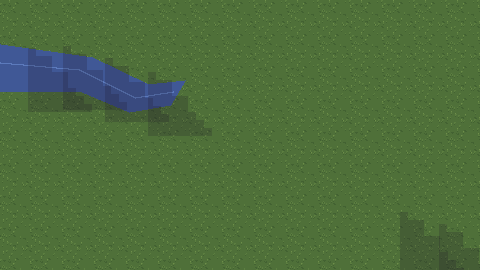
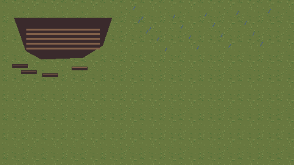
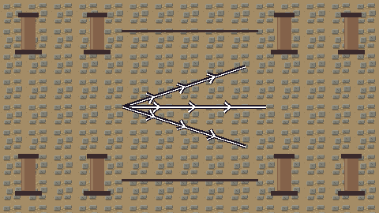
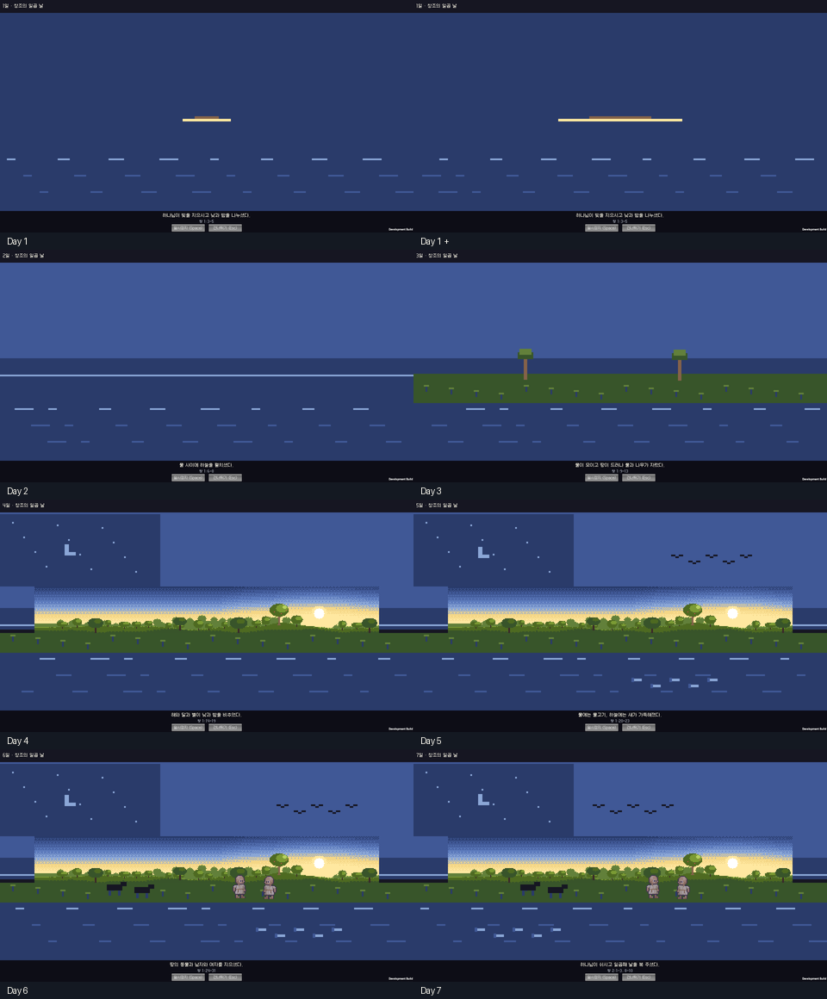
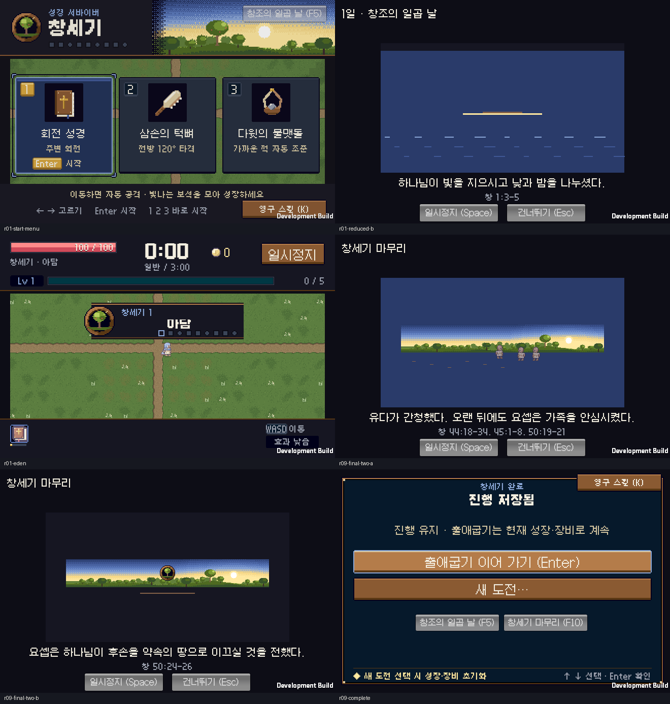

# 창세기 일곱 날과 R09 엔딩 시제품

[이슈 #56](https://github.com/petercorders/Bible-Survivor/issues/56)의 장면표를 Unity에서 재생한다. 첫 R01 저장을 만든 뒤 기동한 타이머를 애니매틱 종료까지 0으로 유지한다. 20초 동안 물과 빛, 하늘, 땅과 풀과 나무, 해·달·별, 물고기와 새, 동물과 두 사람, 일곱째 날 안식이 차례로 보인다. 새 저장에서 시작할 때만 자동으로 연다. 이어 하기는 저장된 화면을 복원하며, PC 시작·일시정지·권 완료 화면의 F5 또는 다시 보기 버튼에서 열 수 있다.

R09는 유다와 요셉 이야기의 마지막 두 컷을 13초로 시험한다. 첫 컷은 시간이 지난 뒤 가족을 안심시키는 요셉을, 둘째 컷은 후손을 향한 약속과 창세기 문장을 보여준다. 정산 작업 ID와 리비전, RunId, R09 완료 영수증을 디스크에서 확인한 뒤 재생한다. 중단하거나 리소스가 없어도 이미 저장된 완료 화면에서 출애굽기를 선택한다. 실패 때는 기존 저장 재시도와 다시 불러오기를 사용한다. 성공을 확인한 재시도는 한 번만 영상을 열고 이미 완료된 저장을 불러오면 화면만 복구한다. PC에서는 F10 또는 완료 화면의 다시 보기 버튼으로 영상을 다시 볼 수 있다.

480×270 레이어를 중앙에서 정수 배율로 표시하고 장절과 자체 한국어 요약을 화면 UI로 표시한다. Enter·Esc·패드 B/동쪽 버튼 또는 마우스로 건너뛰고, Space·패드 Start 또는 마우스로 일시정지한다. 기존 F6 저감 설정은 컷 안의 움직임을 멈추고 장면 순서·내용·시간을 유지한다.

## 아트 인계

Orca 브라우저의 Design 시작 링크는 Claude 로그인으로 이동했다. Claude Code의 Opus 5.5 세션에서 DesignSync는 발견했으나 실제 Design/Artifact 생성 연결을 확보하지 못했다. Design 제품의 Opus 5.5 선택 여부는 미확인이다. 승인된 Design 원본이 도착하면 Claude Code Sonnet 5.5에서 원본을 변환한다. 현재 화면은 기존 창세기 머릿장, 문장, 캐릭터와 팔레트 기반 기술 구성이다.

| ID | 요청 범위 | 승인 조건 |
|---|---|---|
| `genesis-intro` | 480×270 일곱 컷, 3·4·5일 대표 픽셀 컷. 원점은 좌상단이며 하늘·물·땅·생물·빛을 독립 레이어로 분리 | 1920×1080 4배, 660×440 1배. 창세기 팔레트, 첫 프레임 움직임, 정적인 저감 버전, 자막 UI 밑 여백 |
| `genesis-ending` | 480×270의 11–17초, 17–24초 원안에 해당하는 두 장면. 인물 컷 발 기준과 문장 중심 피벗 명시 | 야곱 장례 이후의 안심과 요셉의 약속을 분명히 구분. 마지막은 창세기 문장 |
| `genesis-env-eden` · `genesis-env-ark` · `genesis-env-hall` | 물길과 수관, 방주 골조와 판재, 회랑 기둥. 32×32 타일과 검토용 480×270 합성 | 기존 적 공격 경고의 붉은 주황이나 예고 형태와 구분. 전투의 중앙 시야·충돌·피해에 영향 없음 |

아래 참조는 기존 타일과 팔레트로 만든 정지 배치안이다. 순서대로 에덴 물길, 방주, 회랑이며 화면 가장자리 소품 배치만 보여준다. 실제 전장 적용과 경고 대비 평가는 아트 리뷰에 남긴다.

## 검증 범위

Unity EditMode는 일곱 날·두 컷의 순서와 길이, 화면 정수 배율, 영상 누락·오류 폴백, R09 쓰기 실패와 같은 정산 재시도를 검증한다. PlayMode는 같은 입력을 놓기 전 전투 조작과 이어 가기가 차단되는지, 다시 보기와 기존 R180 완료 흐름을 확인한다. macOS Development Player에는 별도 실험용 입력·캡처 드라이버를 연결하고 기기 입력과 구분해 보고한다.

### 환경 단서와 경고 비교

회랑 배치 위에 기존 R09 사슬 경고의 흰 선, 잉크 외곽선과 세 방향 화살표를 본뜬 검토용 오버레이를 올렸다. 기둥은 가장자리의 갈색 수직 소품이며, 경고는 전장 중앙을 가로지르는 흰 방향선이다. 이 합성은 배치와 대비를 검토하는 자료다. 전투 적용 후의 반응은 최종 아트 검수 항목이다.

### 재현

1. 격리 프로젝트를 만들고 `tools/fixtures/unity_genesis_cinematics_probe.cs.txt`를 `Assets/Adam/Runtime/GenesisCinematicsPlayerProbe.cs`로 복사한다. 제품 체크아웃에는 복사하지 않는다.
2. 격리 EditMode의 `AdamR09HostTests.RewardAndChapterCompletionRetryPreserveThreeReceiptsGrowthAndExplicitNewChallenge`에 임시 내보내기를 추가한다. `fail=failSettlement;var completed=h.CompleteBossSettlement();` 직전에 `failSettlement`가 참이면 `File.Copy(path, outputFile)`로 저장을 복사한다. 해당 저장은 보상과 대기 중 성장을 모두 적용한 정산 직전 기술 픽스처다. Unity 테스트 원본을 복원한 후 Player를 만든다.
3. Unity 6000.6.9f1에서 `-executeMethod BibleSurvivor.Unity.Editor.AdamProject.BuildMac`을 실행한다. Developer 앱을 `-cinematicProbe <새 캡처 디렉터리> <가로> <세로>`와 해상도 인수로 시작한다. 캡처 디렉터리에 위 저장을 `r09-fixture.json`으로 둔다. 드라이버의 저장은 캡처 디렉터리에 생성된다.

### 실행 결과

Apple M4 Pro, macOS 26.5.1, Unity 6000.6.9f1 Development Player에서 보관한 기술 검증이다. Player의 키보드와 패드 검사는 Unity Input System 가상 장치를 사용했다. Unity Editor PlayMode에서 실제 HUD 경로의 포인터 이벤트도 검사했다.

| 구간 | 결과 | 근거 |
|---|---|---|
| Unity EditMode · PlayMode | PASS, 496/496 · 48/48 | `editmode-metal.xml`, `playmode-final.xml`. R180 최종 영수증과 추가 영상 없이 완주 유지 |
| macOS 1920×1080 | PASS, 종료 0 | `player-final-1080p/Player.log`. 일곱 날 재생, 전투 시간·누적 시간 0, 자연 종료 직후 에덴 이동, 물과 빛의 움직임, 대표 컷의 4×4 원본 픽셀 일치 |
| macOS 660×440 | PASS, 종료 0 | `player-final-660/Player.log`. 한국어 자막과 장절, 저감 효과 두 캡처가 픽셀 단위로 일치, 일시정지·스킵·다시 보기 |
| R09 정산과 R10 이어 하기 | 두 크기에서 PASS | 이전 보상까지 적용한 기술 저장에서 정산 쓰기 실패를 주입했다. 실패 때 재생 0회, 재시도 후 저장 확인과 엔딩, 건너뛰기 입력을 유지해도 R09 화면 유지, 다시 누르면 같은 RunId로 R10 진입. 정산 골드 1회 |
| 회귀 검출 | 타이머·정산 변이 각 종료 2, 복원 검사 각 종료 0 | `mutation-timer.xml`의 누적 시간 0 단언, `mutation-settlement.xml`의 실패 중 재생 금지 단언. 복원 XML은 각 1/1, 2/2 PASS |
| 영상 누락 | macOS 660×440에서 PASS, 종료 0 | 두 JSON 리소스를 뺀 별도 QA 빌드 `player-no-clips/Player.log`. R01 타이머·이동과 R09 완료 화면·R10 이어 하기 |
| Core · 휴대 가능한 입력 검사 | PASS | 기존 Core 1,206/1,206, `tools/unity_check_portable.py` PASS. 현재 작업 경로에서 기준 브랜치의 로컬 생성기 해시를 재현하지 못했고, 별도 동기화 사본의 일관성 검사는 PASS. macOS Player는 기준 브랜치에 들어 있는 DLL을 사용 |
| 기타 플랫폼 및 조작 | NOT_RUN | Windows, Android, iOS, Steam 실환경, 실제 하드웨어 패드와 네이티브 클릭, 참가자 이해도 및 최종 아트 검수 |

운영 로그와 원본 PNG는 작업공간의 `evidence/issue56/`에 보관했다. 아래 이미지는 최종 Player에서 캡처했다. 1080p 모음은 문서 표시용으로 축소했다.

