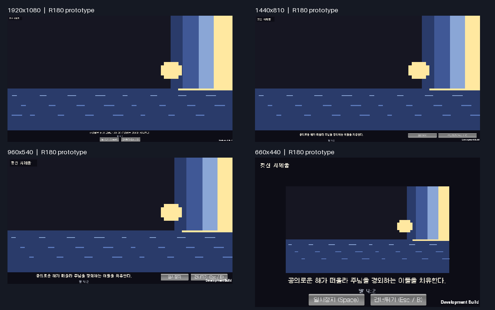

# #63 R180까지 선정 컷신

11편을 12개 재생 경계에 연결한다. 창세기→출애굽기 연결편은 R09 정산 후와 R10 진입 전의 두 구간이다. R09 건너뛰기 뒤에는 정산이 저장된 창세기 완료 화면이 열린다. 다음 책에 진입하려면 그 화면에서 이어 가기를 새로 선택한다. R180 끝 영상은 말라기 보상·최종 정산 및 구약 완주 영수증이 원본 저장에서 확인된 뒤 재생한다.

| 순서 | 경계 | 편 | 출전 및 주요 피사체 | 제작 상태 |
|---|---|---|---|---|
| 기존 | R01 첫 새 프로필 시작 저장 | 창조 | 창 1:3–25 · 첫 빛, 물, 식생, 천체, 동물 | #60 제품 리소스 |
| 기존 | R09 정산 / R10 진입 저장 | 창세기→출애굽기 연결 | 창 50:24–26 / 출 1:6–14 · 회랑, 두루마리, 벽돌 작업장 | #60 제품 리소스 |
| 1차 | R43 진입 | 사사기 | 삿 2:6–10 · 지파들의 길, 돌무덤, 흩어진 지파의 마을 | 기술 시제품 · Claude Design v24 게시 및 내보내기 |
| 1차 | R55 진입 | 사무엘상·하 | 삼상 1:9–18 · 실로, 한나의 기도, 엘리 | 기술 시제품 · Claude Design v24 게시 및 내보내기 |
| 1차 | R180 정산 | 말라기·구약 엔딩 | 말 4:1–2 · 용광로, 공의로운 해, 송아지, R01 첫 빛과 연결 | 기술 시제품 · Claude Design v24 게시 및 내보내기 |
| 후속 | R67 진입 | 열왕기상·하 | 왕상 6:11–13, 8:6–30 · 솔로몬, 언약궤, 성전 | 기술 시제품 |
| 후속 | R94 진입 | 느헤미야 | 느 2:11–18 · 무너진 돌과 불탄 문 | 기술 시제품 |
| 후속 | R121 진입 | 이사야 | 사 6:1–8 · 성전 연기와 숯불 | 기술 시제품 |
| 후속 | R151 진입 | 다니엘 | 단 1:1–20 · 바벨론 왕궁, 뜰과 왕의 식탁 | 기술 시제품 |
| 후속 | R166 진입 | 요나 | 욘 1:4–17 · 폭풍, 깊은 물, 큰 물고기 | 기술 시제품 |
| 후속 | R172 진입 | 하박국 | 합 1:2–4, 2:1–4 · 파수대 | 기술 시제품 |

## 재생과 저장

- 원본 저장에서 같은 리비전·작업 ID·RunId 및 진입 전장 또는 적용된 정산을 확인한 뒤 한 번 전달한다. 쓰기 실패와 응답 유실은 같은 저장 작업을 재시도한다. 재실행은 저장 상태를 복원하며 컷신 다시 보기는 현재 저장을 수정하지 않는다.
- Esc, 패드 B, 화면의 건너뛰기 버튼으로 재생 시작 프레임부터 건너뛸 수 있다. 컷신을 닫을 때 누르고 있던 메뉴·이동 입력은 다음 상태로 넘기지 않는다. 자막 데이터가 없거나 잘못되면 저장된 진입 또는 완료 흐름을 계속한다.
- 시작·일시정지·완료 화면의 컷신 다시 보기(F4, 패드 Select)는 도달한 구간을 연다. 기존 F5 창조, F10 창세기 마무리 단축키도 지원한다. 재생에서 돌아오면 직전 화면의 저장·일시정지 상태를 유지한다.
- 신규 기술 시제품은 런타임 글자와 기존 스프라이트·도형을 사용하며 화면에 시제품으로 표시한다.

## Claude Design 인계와 전장 조율

첫 제작 요청은 `r43-judges`, `r55-samuel`, `r180-malachi`다. 각 3컷, 13초·13.5초·14초의 시작 타임라인을 사용한다. 480×270, 12fps, 좌상단 원점, 중요 피사체 y≤238, 분리 레이어·합성 PNG·4096px 이하 분할 아틀라스·저감 정지본 및 해시·제작 출처를 요청했다. R43/R55 마지막 컷은 전장 합성용 알파를 인계하고 R180은 첫 빛의 구도와 일치하는 여운으로 닫는다. 담당자가 비공개 Claude Design v24를 게시했다. 담당자 재조회에서 게시된 장면 소스와 로컬 원본 SHA-256이 일치했다. 개별 컷의 원본 내보내기와 검수는 진행 중이다. 제품에 임포트하는 원본은 장면·픽셀·안전 영역·출처 및 실제 무음 화면을 별도로 검수한다.

#60이 기존 R01/R09/R10 원본과 R10 마지막 컷의 전장 표현을 맡는다. #62는 창세기 전장 소품·좌표를 맡고 #64는 후속 전장 지형을 맡는다. #63은 최종 R43/R55 아트의 전환에서 전장 리소스를 읽을 예정이다. 이 Mac Unity·Player·GUI는 #56→#61→#63 순으로 인계했다. #61은 R09 사슬 흰 화살표가 선반·은잔 위에서 먼저 읽혀야 한다고 확인했다. 전장 소품과 기록 배치는 해당 이슈에서 관리한다.

## 검증

| 확인 | 상태 및 근거 |
|---|---|
| 공개 base 접수 | `issue/56@3f31bcd7cc3087e389b5ed9f8dd0a22ed1a62a91`, #60과 일치. 접수 후 문서만 갱신 |
| Roslyn 명령행 컴파일 | Runtime, EditMode, PlayMode 소스 PASS |
| Unity 6000.6.9f1 EditMode | PASS 29/29 · 저장 경계, 12구간 데이터, 4개 자막 위치 |
| Unity 6000.6.9f1 PlayMode | PASS 5/5 · 키 해제, 마우스 다시 보기, R09/R10 독립 스킵, R180 저장 응답 유실·재실행·영수증 |
| 무음 Development Player | PASS · 1920×1080 테두리 없는 전체 화면, 1440×810·960×540·660×440 창 모드. 크기마다 26개 자동 확인. R01과 R43/R55/R180 기술 시제품, 키보드·패드 스킵, 정산 완료 화면, 기존 R180 영수증과 저장 바이트 확인 |
| 실제 R180 리소스 누락 | PASS · 격리 Player에서 R180 JSON을 빼고 660×440으로 실행. R180 정산 후 완료 화면, 골드·보스 선택·완주 영수증 유지, 재정산 거절 |
| 저장 변이 | PASS · R10 원본 확인을 백업 허용 읽기로 바꾸면 응답 유실 테스트가 실패(종료 2). 원본 복원 후 실제 누락 Player 빌드와 실행 PASS |
| Core 및 Art | PASS · `tools/check_all.py` 종료 0, Core 1,263/1,263, `tools/check_art.py` 및 휴대성 검사 종료 0 |
| 로컬 Core 생성 입력 | FAIL · `tools/unity_check_project.py`에서 체크아웃 SDK의 생성 파일 해시가 기존 서명과 다름. #63은 Core 원본과 기록된 Unity Core 산출물을 변경하지 않음 |
| 독립 리뷰 | PASS · 첫 중립 프레임 이동과 마우스 이벤트 순서 수정 및 재검토. 최종 원본 아트 QA 대기 |
| 신규 Claude Design 아트 | 첫 배치 v24 게시. 세 편의 9개 컷 내보내기·독립 검수와 후속 6편 대기 |

Unity 검증은 오디오가 비활성화된 격리 프로젝트에서 `-noaudio`로 실행했다. 테스트가 생성하는 AudioClip의 샘플 데이터 경고는 로그에 남겼다. 제품 오디오 설정과 시스템 볼륨은 바꾸지 않았다.

로컬 증거는 `evidence/issue63-mute-qa/`의 `edit-final.xml`, `play-final.xml`, `mutation-r10.xml`, `final-*` 및 `missing-660x440/`에 있다. 캡처에서 660×440 자막 끝이 잘려 글자 크기와 자막 영역 배치를 조정했다. 1080p는 첫 창 모드가 1920×1018로 제한되어 실제 1920×1080 전체 화면으로 다시 확인했다.
