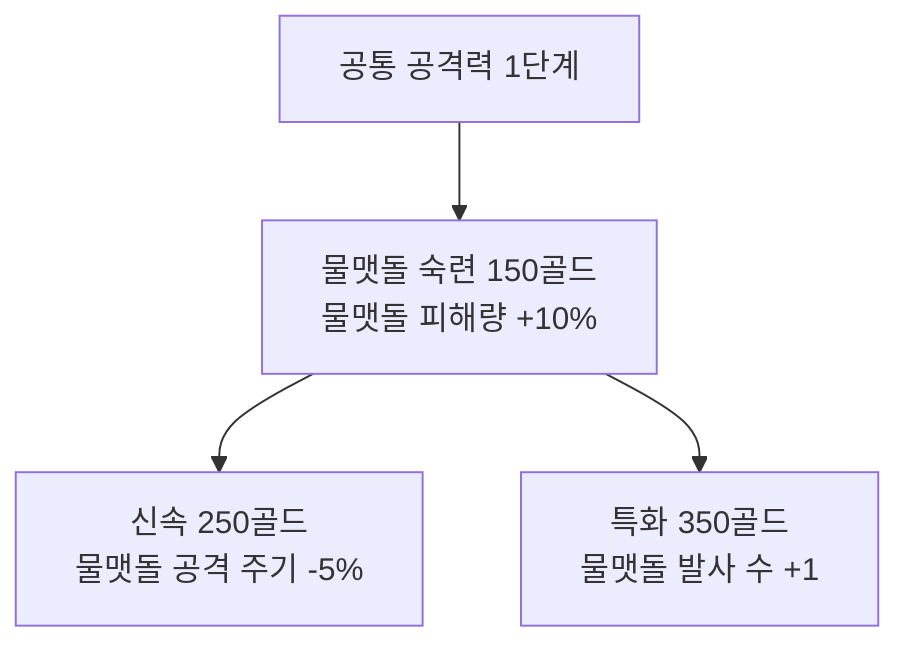

# 골드로 성장하는 영구 스킬트리

기존의 독립적인 영구 강화 상품을 선행 노드가 있는 스킬트리로 바꾼다. 공통 능력치와 무기별 특화를 함께 제공한다. 골드를 직접 사용해 노드와 단계를 구매하며 별도의 스킬 포인트 재화는 추가하지 않는다. 죽어도 구매한 노드는 유지하고 효과는 새 도전부터 적용한다.

이 문서는 트리 구조와 무기별 효과의 기준이다. 무기별 30노드의 이름과 효과 개요는 weapon-skill-trees.md, 골드 수입과 공통 노드의 단계별 가격은 gold-shop.md, 전투 중 강화와 진화는 genesis-balance.md와 item-recommendations.md를 따른다. 아래 효과·가격은 플레이 검증 전 초기값이다.

## 전체 규모와 작성 상태

사용자 요청에 따라 무기별 규모를 이전 15노드에서 최소 두 배로 늘린다. 최종 구성 목표는 공통 트리 12개와 무기별 트리 10개, 총 22개 트리·420종의 고유 노드다. 같은 공격력 노드를 여러 단계 구매하는 것은 고유 노드 수에 중복 산정하지 않는다.

현재 수치·가격을 작성한 것은 기초 공통 노드 8종과 기초 무기 노드 30종, 총 38종이다. 이 기초 공통 노드의 반복 강화까지 포함한 구매 단계는 총 60단계다. 추가 무기 노드 270종의 이름과 효과 개요도 weapon-skill-trees.md에 작성하여 무기 전체 300종의 개요를 갖췄다. 공통 8종을 합치면 개요가 있는 노드는 308종이며 공통의 나머지 112종은 추가 작성 대상이다. 전체 420종의 가격·세부 수치를 확정한 상태는 아니다. 공격·생존·탐색은 큰 분류이고, 그 안에 공통 세부 트리 12개를 배치한다.

| 큰 분류 | 세부 트리 | 트리 수 | 트리당 고유 노드 | 합계 |
| --- | --- | --- | --- | --- |
| 공격 | 위력·치명타·연사·범위·지속·투사체 | 6 | 10 | 60 |
| 생존 | 체력·방어·회복·기동 | 4 | 10 | 40 |
| 탐색 | 경험치·수집 | 2 | 10 | 20 |
| 무기별 | 현재 주무기 10종의 전용 트리 | 10 | 30 | 300 |
| 전체 | 공통 12개와 무기 10개 | 22 | — | 420 |

공통 노드에는 단순 수치뿐 아니라 조건부 강화와 선택지를 다루는 편의 효과도 배분한다. 무기별 30노드는 회전 궤도·도탄·관통·표적 선정·소환수 협공·귀환 경로·지속 지역·진화 후 추가 효과처럼 무기의 동작을 구분한다. 각 노드의 효과 개요는 별도 문서에 명시하고 정확한 수치·우선순위는 후속 설계에서 채운다.

### 무기 트리의 30노드 배분

- 기초 5노드: 기존 숙련·신속·특화와 무기 고유의 기초 노드 2종.
- 고유 갈래 4개에 각각 5노드: 무기별 동작과 역할을 강화하는 20종.
- 진화 연계 5노드.

무기마다 6개의 세부 갈래로 구성한다. 현재 작성된 숙련·신속·특화 3노드를 재사용하고 추가 27노드의 개요를 작성했다. 진화 연계 가지는 해당 무기의 진화 경험 업적으로 열고, 도전에서 실제 진화했을 때 효과가 켜진다. 이 노드들은 진화의 필수 조건이 아니다. 무기 진화의 기본 조건은 기존대로 주무기 8레벨과 대응 보조다.

전체 420종을 한꺼번에 구매 가능하게 하지 않고 선행 노드·무기 해금·진행 업적으로 가지를 단계적으로 연다. 전체 트리는 미리 볼 수 있게 하며 잠긴 이유를 표시한다. 영구 구매와 무료 전체 환불·새 도전 적용 규칙은 유지한다. 초기 공격력·공격 간격 등의 상한을 420개 노드 수만큼 단순 누적하지 않고, 특화 경로와 효과별 상한을 후속 설계에서 정한다.

현재의 공통 비용 14,450골드와 기초 무기 노드 비용 7,500골드는 가격을 작성한 38종의 비용이다. 전체 420종의 총가격과 개방 순서는 아직 미정이며 초기 경제안과 혼동하지 않는다.

## 공통 능력치 가지

세 가지 시작점은 무료로 열려 있다. 연결된 노드의 선행 조건을 충족하면 골드로 다음 노드의 첫 단계를 구매할 수 있다. 다른 가지를 동시에 찍을 수 있고 한 직업으로 고정하지 않는다.

| 가지 | 노드 | 구매 가능 조건 | 최대 단계·효과 |
| --- | --- | --- | --- |
| 공격 | 공격력 | 처음부터 | 5단계, 단계당 +3%p, 최대 +15% |
| 공격 | 재사용 대기시간 | 공격력 3단계 | 3단계, 단계당 -2%p, 최대 -6% |
| 생존 | 최대 체력 | 처음부터 | 5단계, 단계당 +10%p, 최대 +50% |
| 생존 | 방어력 | 최대 체력 2단계 | 3단계, 단계당 +1, 최대 +3 |
| 생존 | 체력 회복 | 방어력 1단계 | 3단계, 단계당 초당 +0.1, 최대 +0.3 |
| 탐색 | 경험치 획득 범위 | 처음부터 | 5단계, 단계당 +10%p, 최대 +50% |
| 탐색 | 이동속도 | 획득 범위 2단계 | 3단계, 단계당 +5%p, 최대 +15% |
| 탐색 | 경험치 획득량 | 이동속도 1단계 | 3단계, 단계당 +3%p, 최대 +9% |

공통 노드의 단계별 가격은 기존 경제안대로 유지하며 전체 공통 강화 비용은 14,450골드다. 새로 생긴 연결 관계를 반영해 구매 가능한 순서는 달라진다.

## 무기별 가지

각 무기는 공통 공격력 1단계 이상과 해당 무기 영구 해금을 갖추면 숙련 노드를 열 수 있다. 초기 해금된 세 무기는 처음부터 이 조건을 확인하고 나머지 무기는 진행으로 해금한 뒤 가지가 열린다. 구매 전에도 가지와 효과를 미리 볼 수 있다.

무기마다 30개 노드를 두고, 그중 기초 세 노드의 수치와 가격은 다음과 같다.

- 숙련: 150골드, 해당 무기 피해량 +10%p, 1단계. 공통 공격력 1단계와 무기 해금 필요.
- 신속: 250골드, 해당 무기 공격 주기 또는 대기시간 -5%p, 1단계. 해당 숙련 필요.
- 특화: 350골드, 아래의 고유 효과, 1단계. 해당 숙련 필요.

숙련 이후 신속과 특화로 갈라진다. 둘 중 원하는 쪽부터 구매하고, 골드를 더 모으면 둘 다 구매할 수 있다. 각 무기의 기초 세 노드 비용은 합계 750골드이며 30개 전체 비용은 아니다.

### 무기 10종의 특화 노드

| 무기 | 특화 노드 | 영구 효과 |
| --- | --- | --- |
| 회전 성경 | 한 권 더 | 회전 성경 수량 +1 |
| 삼손의 턱뼈 | 연속 휘두르기 | 한 주기의 휘두르기 +1회 |
| 다윗의 물맷돌 | 추가 투석 | 한 주기의 물맷돌 발사 수 +1 |
| 모세의 지팡이 | 갈라지는 물결 | 한 주기의 물결 수 +1 |
| 다니엘의 사자 | 사자의 동행 | 소환 사자 수 +1 |
| 불기둥 | 쌍불기둥 | 한 주기의 불기둥 생성 수 +1 |
| 하늘의 번개 | 추가 낙뢰 | 한 주기의 낙뢰 수 +1 |
| 십자가 | 쌍십자가 | 한 주기의 십자가 발사 수 +1 |
| 광야의 외침 | 넓은 외침 | 해당 무기의 공격 범위 +20%p |
| 엘리야의 불수레 | 불수레 행렬 | 한 주기의 불수레 수 +1 |

표는 각 무기의 기초 특화 노드 1종씩을 보여준다. 나머지 고유 노드는 weapon-skill-trees.md를 따른다. 광야의 외침은 별도의 메아리를 시작부터 추가하기보다 범위를 늘린다. 메아리 추가는 기존 진화의 특징으로 유지한다. 턱뼈의 특화 추가 타격은 기존 타격 간격 0.15초로 이어진다.

무기 해금과 스킬 구매는 별개다. 물맷돌 특화를 사도 시작 무기를 물맷돌로 강제하지 않고 다른 시작 무기를 선택할 수 있다. 도전 중 물맷돌을 획득하면 해당 도전 시작 시 저장한 물맷돌 노드 효과를 적용한다. 스킬 구매만으로 무기를 시작 장비에 추가하거나 무기 슬롯을 차지하지 않는다.

## 전투 강화와의 합산

영구 스킬은 매 도전의 출발점을 강화한다. 전투 중 무기 레벨업·보조 획득·진화는 기존대로 필요하다. 영구 노드는 무기 레벨을 올리거나 대응 보조를 대신하지 않는다.

- 피해 배율 = 1 + 공통 영구 공격력 + 해당 무기 숙련 + 삼손의 머리카락 등 전투 피해 보너스.
- 대기 배율 = max(0.2, 1 - 공통 영구 대기 감소 - 해당 무기 신속 - 우레 등 전투 대기 감소).
- 수량 = 해당 무기 레벨의 기본 수량 + 해당 무기 특화 수량 + 매끄러운 다섯 돌 등 적용 가능한 보조 수량.
- 범위 배율 = 1 + 해당 무기 특화 범위 + 회오리바람 등 전투 범위 보너스.

예를 들어 물맷돌 1레벨은 기본 1발이며, 추가 투석을 구매하면 새 도전에서 2발로 시작한다. 같은 도전에서 물맷돌을 2레벨로 강화하면 기본 수량이 2가 되어 특화와 합쳐 3발이다. 물맷돌 8레벨 기본 4발에 특화 +1과 다섯 돌 최대 +2를 합치면 7발이다.

진화에서는 기본 무기의 완성 수치에 이미 포함된 영구 효과를 다시 더하지 않는다. 물맷돌 진화의 기본 다섯 돌 연사는 기본 수량 5에 특화 +1과 보조 +2를 한 번씩 합쳐 최대 8발이다. 진화 시 base 수량이 4에서 5로 교체되는 것이며 기존 수량 전체에 5를 더하는 것이 아니다. 다른 진화형도 해당 노드를 한 번만 계승한다.

공통 공격력 최대 +15%, 물맷돌 숙련 +10%, 머리카락 최대 +50%를 함께 갖추면 물맷돌 피해는 기본의 175%다. 공통 대기 감소 -6%, 물맷돌 신속 -5%, 우레 최대 -40%를 합치면 물맷돌 주기는 기본의 49%다. 회전 성경처럼 지속 종료 후 대기를 시작하는 무기는 대기 부분만 줄인다.

## 비용과 첫 구매 흐름

- 공통 노드 전체: 14,450골드.
- 무기별 세 노드 전체: 무기당 750골드 × 10종 = 7,500골드.
- 현재 가격을 작성한 기초 38종의 전체 비용: 21,950골드. 목표 420종 전체 비용은 별도 설계한다.

첫 라운드 표 기준 73골드로 획득 범위 1단계 60골드를 구매할 수 있다. 공격 위주로 가려면 100골드로 공통 공격력 1단계, 추가 150골드로 원하는 무기 숙련, 추가 350골드로 특화를 구매한다. 물맷돌 발사 수 +1까지의 최소 비용은 총 600골드다.

첫 보스까지의 표 기준 426골드로 공통 공격력 1단계와 물맷돌 숙련을 구매하고 176골드를 남길 수 있다. 표 기준 4라운드까지 611골드를 얻으면 물맷돌 특화까지 구매할 수 있다. 이는 해당 진행 후 메인 메뉴에서 새 도전을 준비할 때의 예시다. 살아 있는 도전을 이어 하는 동안 효과를 소급 적용하지 않는다.

## 화면과 환불

메인 메뉴의 골드 상점을 영구 스킬트리 화면으로 표시한다. 공통 가지와 무기별 가지를 탭으로 나누고, 무기 가지는 무기 아이콘과 이름으로 구분한다. 노드는 미해금·선행 조건 부족·구매 가능·구매 완료 상태를 표시한다. 노드를 선택하면 효과·가격·조건·적용되는 무기·현재와 다음 수치를 보여준다.

새 도전부터 적용된다는 안내와 현재 잔액을 항상 표시한다. 클릭 한 번으로 한 단계만 구매하고 선행 조건과 잔액을 다시 확인한다. 구매 성공 시 연결선과 노드 상태를 갱신한다.

기존 무료 전체 환불은 공통 노드와 무기 노드 전체에 적용한다. 실제 구매한 모든 비용을 돌려주고 구매 노드를 비운다. 진행 무기 해금은 유지한다. 초기 버전은 개별 선행 노드 환불을 제공하지 않아 후속 노드만 남는 상태를 피한다. 중단한 도전은 시작 당시 노드 사본으로 재개하므로 환불 후에도 능력치가 바뀌지 않는다.

## 검증할 사항

1. 잠긴 무기 가지를 골드만으로 우회 구매할 수 없는지 확인.
2. 공통 가지와 무기 가지의 선행 조건·구매 순서가 맞는지 확인.
3. 물맷돌 시작 2발, 2레벨 3발, 최대 강화와 보조 포함 7발이 맞는지 확인.
4. 진화 이후 특화 수량과 피해 보너스가 중복 적용되지 않는지 확인.
5. 장비를 갖고 있지 않은 무기 노드가 다른 무기에 적용되지 않는지 확인.
6. 구매·전체 환불·재구매의 잔액과 트리 상태가 일치하는지 확인.
7. 무강화·공통 위주·특정 무기 특화 빌드가 각각 진행 가능한지 플레이 검증.
